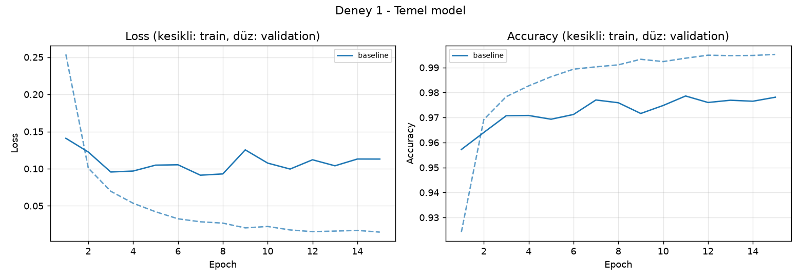
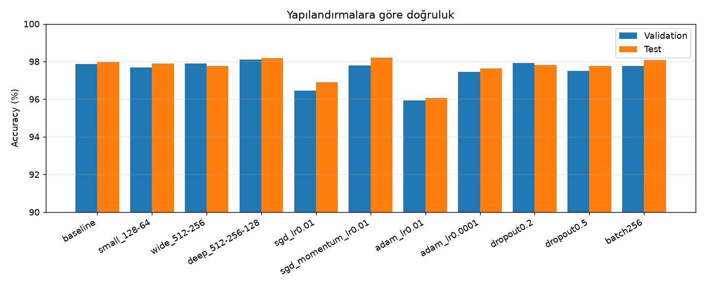
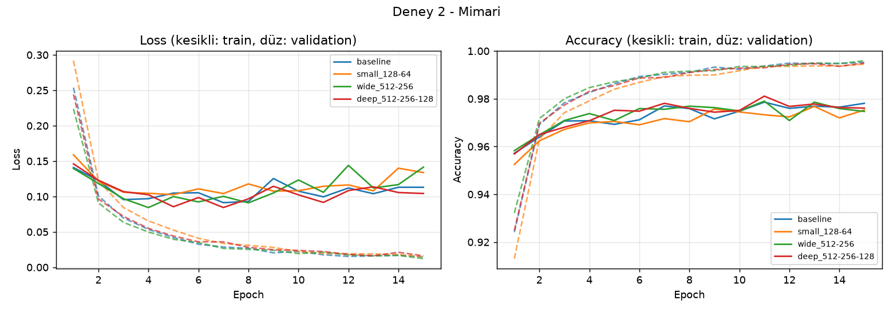
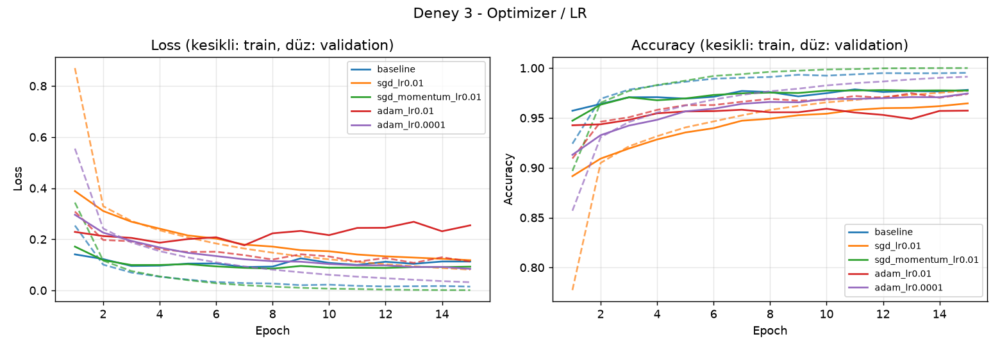
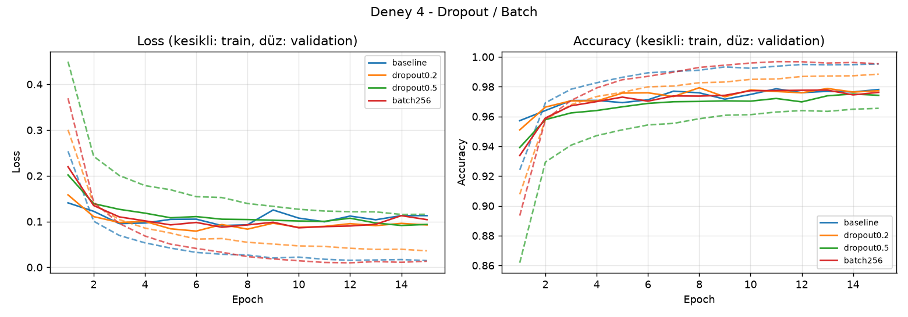
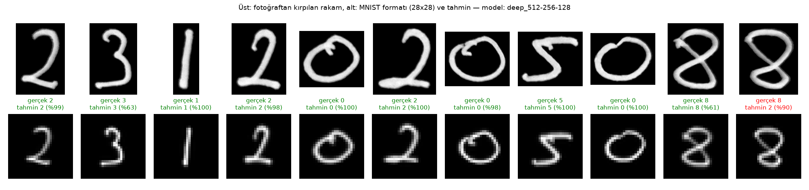

# BIL485 Derin Öğrenme – Ödev 1: MNIST ile MLP Tabanlı El Yazısı Rakam Tanıma

**Öğrenci:** Ahmet Burak Sipahi – 23120205088

Bu çalışmada MNIST veri seti üzerinde **Multi-Layer Perceptron (MLP)** modelleri PyTorch ile sıfırdan eğitildi. Farklı mimari ve hiperparametre yapılandırmaları karşılaştırıldı. Validation sonucuna göre seçilen en iyi model, kendi el yazımla yazdığım öğrenci numaram üzerinde test edildi.

- CNN kullanılmadı, yalnızca tam bağlantılı (`nn.Linear`) katmanlar var.
- Hazır eğitilmiş model kullanılmadı, tüm modeller sıfırdan eğitildi.
- Test verisi model geliştirme ve seçimde **kullanılmadı**.

---

## 1. Veri Seti ve Ayrım

| Küme | Örnek sayısı | Kaynak | Kullanım |
|---|---|---|---|
| Train | 50.000 | MNIST eğitim setinin %83'ü | Ağırlıkların öğrenilmesi |
| Validation | 10.000 | MNIST eğitim setinin %17'si | Epoch ve model seçimi |
| Test | 10.000 | MNIST resmi test seti | Yalnızca en sonda, bir kez |

- Train/validation ayrımı `random_split` ile **sabit seed (42)** kullanılarak yapıldı, her çalıştırmada aynı ayrım elde edilir (`src/data.py`).
- Görüntüler 28×28 gri seviye, 10 sınıf (0–9).
- Ön işleme: `ToTensor()` ile [0, 1] aralığı, ardından MNIST ortalaması ve standart sapmasıyla normalizasyon (`mean=0.1307, std=0.3081`).

**Test verisinin korunması:** Her yapılandırma yalnızca train ile eğitildi. Her epoch sonunda validation doğruluğu ölçüldü ve en yüksek validation doğruluğunun alındığı epoch'un ağırlıkları saklandı. Modeller arasından en iyisi yine **yalnızca validation doğruluğuna** göre seçildi. Test seti, tüm eğitim ve seçim bittikten sonra her model için bir kez değerlendirildi (`src/experiments.py`).

## 2. Model ve Eğitim Ayarları

```
Girdi (28x28) → Flatten (784) → [Linear → ReLU (→ Dropout)] × k → Linear (10)
```

| Ayar | Değer |
|---|---|
| Aktivasyon | ReLU |
| Kayıp fonksiyonu | CrossEntropyLoss (softmax dahili) |
| Optimizer (temel) | Adam, lr = 0.001 |
| Batch size (temel) | 64 |
| Epoch | 15 (en iyi validation epoch'u saklanır) |
| Seed | 42 (veri ayrımı, karıştırma ve ağırlık başlatma) |
| Donanım | CPU (8 çekirdek), GPU yok |

## 3. Deneyler

Temel modelden başlayarak her deney grubunda **yalnızca bir ayar** değiştirildi. Böylece her değişikliğin etkisi ayrı ayrı görülebiliyor.

| Grup | Model adı | Gizli katmanlar | Optimizer | LR | Batch | Dropout |
|---|---|---|---|---|---|---|
| Deney 1 | `baseline` | 256-128 | Adam | 1e-3 | 64 | 0 |
| Deney 2 – Mimari | `small_128-64` | 128-64 | Adam | 1e-3 | 64 | 0 |
| | `wide_512-256` | 512-256 | Adam | 1e-3 | 64 | 0 |
| | `deep_512-256-128` | 512-256-128 | Adam | 1e-3 | 64 | 0 |
| Deney 3 – Optimizer/LR | `sgd_lr0.01` | 256-128 | SGD | 1e-2 | 64 | 0 |
| | `sgd_momentum_lr0.01` | 256-128 | SGD + momentum 0.9 | 1e-2 | 64 | 0 |
| | `adam_lr0.01` | 256-128 | Adam | 1e-2 | 64 | 0 |
| | `adam_lr0.0001` | 256-128 | Adam | 1e-4 | 64 | 0 |
| Deney 4 – Düzenlileştirme | `dropout0.2` | 256-128 | Adam | 1e-3 | 64 | 0.2 |
| | `dropout0.5` | 256-128 | Adam | 1e-3 | 64 | 0.5 |
| | `batch256` | 256-128 | Adam | 1e-3 | 256 | 0 |

## 4. Sonuçlar

### Deney 1 – Temel MLP Modeli

En iyi validation doğruluğu **11. epoch**'ta alındı. Değerler o epoch'a aittir.

| Metrik | Değer |
|---|---|
| Training loss | 0.0177 |
| Validation loss | 0.0995 |
| Training accuracy | %99.37 |
| Validation accuracy | %97.86 |
| **Test accuracy** | **%97.97** (test loss 0.0966) |
| Eğitim süresi (15 epoch) | 79.7 sn |
| Parametre sayısı | 235.146 |



**Yorum:** Training loss 15 epoch boyunca düzenli olarak azalıyor (0.25 → 0.015). Validation loss ise **7. epoch'ta en düşük değerine (0.091)** ulaşıp sonra 0.11'e yükseliyor. Training accuracy %99.5'e çıkarken validation accuracy %97.2–97.9 aralığında dalgalanıyor. Bu ayrışma, modelin 7. epoch'tan sonra eğitim verisini **ezberlemeye (overfitting)** başladığını gösteriyor. Bu nedenle son epoch yerine en iyi validation epoch'unun ağırlıkları kullanıldı (bir tür early stopping).

### Tüm yapılandırmaların karşılaştırması

| Model | En iyi epoch | Train loss | Train acc | Val loss | Val acc | Test loss | **Test acc** | Parametre | Süre (sn) |
|---|---|---|---|---|---|---|---|---|---|
| baseline | 11 | 0.0177 | 99.37 | 0.0995 | 97.86 | 0.0966 | **97.97** | 235.146 | 79.7 |
| small_128-64 | 13 | 0.0188 | 99.38 | 0.1080 | 97.68 | 0.1027 | **97.89** | 109.386 | 67.1 |
| wide_512-256 | 11 | 0.0213 | 99.35 | 0.1059 | 97.90 | 0.0984 | **97.76** | 535.818 | 94.9 |
| **deep_512-256-128** ⭐ | 11 | 0.0223 | 99.30 | 0.0916 | **98.11** | 0.0779 | **98.19** | 567.434 | 93.5 |
| sgd_lr0.01 | 15 | 0.0810 | 97.73 | 0.1180 | 96.46 | 0.0977 | **96.89** | 235.146 | 51.0 |
| sgd_momentum_lr0.01 | 12 | 0.0028 | 99.97 | 0.0880 | 97.79 | 0.0694 | **98.20** | 235.146 | 53.6 |
| adam_lr0.01 | 10 | 0.1328 | 96.81 | 0.2162 | 95.92 | 0.2017 | **96.07** | 235.146 | 71.5 |
| adam_lr0.0001 | 15 | 0.0319 | 99.13 | 0.0841 | 97.45 | 0.0721 | **97.64** | 235.146 | 52.0 |
| dropout0.2 | 8 | 0.0547 | 98.27 | 0.0834 | 97.93 | 0.0781 | **97.81** | 235.146 | 59.7 |
| dropout0.5 | 14 | 0.1156 | 96.49 | 0.0915 | 97.51 | 0.0809 | **97.77** | 235.146 | 60.9 |
| batch256 | 13 | 0.0126 | 99.58 | 0.0941 | 97.77 | 0.0817 | **98.08** | 235.146 | 44.1 |

⭐ Validation doğruluğuna göre seçilen en iyi model: **`deep_512-256-128`**



### Deney 2 – Mimari (derinlik ve genişlik)



- **Küçük model (128-64):** Parametre sayısı temel modelin yarısından az (109 bin), ama doğruluk yalnızca ~0.1–0.2 puan düşük. MNIST için 235 bin parametre bile gereğinden fazla.
- **Geniş model (512-256):** Validation loss **4. epoch'ta** en düşük değerine (0.084) iniyor, 15. epoch'ta 0.14'e çıkıyor. Kapasite arttıkça ezberleme daha erken ve daha belirgin başlıyor.
- **Derin model (512-256-128):** En yüksek validation (%98.11) ve test (%98.19) doğruluğu. Üçüncü gizli katman, aynı genişlikteki 2 katmanlı modele göre daha iyi genelledi.
- Daha büyük modeller epoch başına daha uzun sürüyor (94 sn, temel model 80 sn).

### Deney 3 – Optimizer ve öğrenme oranı



- **SGD (momentumsuz, lr=0.01):** İlk epoch'ta validation doğruluğu yalnızca %89. 15 epoch sonunda validation loss hâlâ düşüyor, yani model **yakınsamadı**. Daha fazla epoch gerekiyor.
- **SGD + momentum 0.9:** Aynı öğrenme oranıyla çok daha hızlı öğreniyor ve en yüksek test doğruluğuna (%98.20) ulaşıyor. Ancak train accuracy %100'e çıkıyor (train loss 0.0009), bu da eğitim verisini tamamen ezberlediğini gösteriyor.
- **Adam lr=0.01 (10 kat büyük):** En kötü sonuç (%96.07). Adımlar çok büyük olduğu için loss dalgalanıyor, validation loss 0.18'den 0.25'e çıkıyor. **Öğrenme oranı en kritik hiperparametre.**
- **Adam lr=0.0001 (10 kat küçük):** Yavaş ama düzgün öğreniyor. Validation loss 15 epoch boyunca düşmeye devam ediyor ve train/val farkı en az olan modellerden biri. Daha uzun eğitilirse daha iyi sonuç verebilir.

### Deney 4 – Dropout ve batch size



- **Dropout 0.2:** En düşük validation loss bu modelde (0.079). Train ve validation loss birbirine en yakın olan yapılandırma, yani dropout overfitting'i azaltıyor.
- **Dropout 0.5:** Fazla düzenlileştirme. Train accuracy %96.5'te kalıyor, validation accuracy'nin bile altında; model kapasitesinin bir kısmını kullanamıyor.
- **Batch size 256:** Epoch başına 4 kat az güncelleme yapıldığı için **en hızlı** eğitim (44 sn), doğruluk temel modele çok yakın (%98.08).

## 5. Kendi El Yazımla Test

### Görüntünün hazırlanması

Beyaz kâğıda mavi kalemle öğrenci numaramı (**23120205088**) yazdım ve telefonla fotoğrafını çektirdim.

| Adım | Açıklama | Dosya / kod |
|---|---|---|
| Orijinal fotoğraf | iPhone HEIC, 3000×4000, yazı 90° dönük | `handwriting/numara_orijinal.heic` |
| Kırpma ve döndürme | Fotoğraftaki zarf kenarı dışarıda bırakıldı, saat yönünde 90° döndürüldü | `src/fotograf_hazirla.py` → `handwriting/numara.jpg` |
| Gri tonlama ve gölge düzeltme | Büyük Gauss bulanıklığıyla arka plan aydınlatması tahmin edilip görüntü buna bölündü | `ink_map()` |
| Renk ters çevirme | MNIST'teki gibi arka plan siyah, rakam beyaz | `ink_map()` |
| Rakamlara ayırma | Otsu eşikleme + bağlantılı bileşenler, soldan sağa sıralama. Her rakam yalnızca kendi pikselleriyle kırpıldı (komşu rakam parçaları maskelendi) | `segment_digits()` |
| 28×28'e dönüştürme | En-boy oranı korunarak 20×20 kutuya sığdırma, 28×28 tuvalde **ağırlık merkezine göre** ortalama (MNIST'in orijinal yöntemi) | `to_mnist()` |
| Normalizasyon | Eğitimdekiyle aynı (`mean=0.1307, std=0.3081`) | `predict()` |

```bash
python src/fotograf_hazirla.py handwriting/numara_orijinal.heic handwriting/numara.jpg --crop 900 950 1530 3150 --rotate -90
python src/handwriting.py handwriting/numara.jpg --expected 23120205088
```

### Sonuç (en iyi model: `deep_512-256-128`)



| | |
|---|---|
| Gerçek | `2 3 1 2 0 2 0 5 0 8 8` |
| Tahmin | `2 3 1 2 0 2 0 5 0 8 2` |
| **Doğruluk** | **10/11 = %90.9** |

| Rakam | 2 | 3 | 1 | 2 | 0 | 2 | 0 | 5 | 0 | 8 | 8 |
|---|---|---|---|---|---|---|---|---|---|---|---|
| Tahmin | 2 | 3 | 1 | 2 | 0 | 2 | 0 | 5 | 0 | 8 | **2** ❌ |
| Güven | %99 | %63 | %100 | %98 | %100 | %100 | %98 | %100 | %100 | %61 | %90 |

Ayrıntılı çıktı: `results/handwriting/sonuc.json`

### Tüm modellerin el yazısı üzerindeki sonucu (yalnızca analiz amaçlı)

Model seçimi validation ile yapıldı. Aşağıdaki tablo seçimi değiştirmek için değil, MNIST başarısı ile gerçek veri başarısının ne kadar örtüştüğünü görmek için hazırlandı (`results/handwriting/tum_modeller.json`).

| Model | MNIST test acc | Tahmin | El yazısı acc |
|---|---|---|---|
| baseline | 97.97 | 23120205033 | 81.8 |
| small_128-64 | 97.89 | 23120205022 | 81.8 |
| wide_512-256 | 97.76 | 23120205082 | 90.9 |
| deep_512-256-128 | 98.19 | 23120205082 | 90.9 |
| sgd_lr0.01 | 96.89 | 25110205082 | 72.7 |
| sgd_momentum_lr0.01 | 98.20 | 25120205082 | 81.8 |
| adam_lr0.01 | 96.07 | 23128285882 | 63.6 |
| adam_lr0.0001 | 97.64 | 23120205022 | 81.8 |
| dropout0.2 | 97.81 | 21120205088 | 90.9 |
| dropout0.5 | 97.77 | 25120205082 | 81.8 |
| batch256 | 98.08 | 23120205022 | 81.8 |

## 6. Genel Değerlendirme

**MNIST üzerinde:** Basit bir MLP bile test setinde %98 civarı doğruluğa ulaşıyor. En iyi sonuç üç gizli katmanlı modelde alındı (%98.19). Deneylerden çıkan başlıca sonuçlar:

1. **Öğrenme oranı en kritik hiperparametre.** Adam'da lr'yi 10 kat büyütmek doğruluğu %96'ya düşürdü, 10 kat küçültmek öğrenmeyi yavaşlattı.
2. **Momentum, SGD'yi Adam ile rekabet edebilir hâle getiriyor.** Momentumsuz SGD 15 epoch'ta yakınsamadı.
3. **Kapasite arttıkça overfitting erkenleşiyor.** Validation loss'un en düşük olduğu epoch geniş modelde 4, temel modelde 7. Hemen her modelde train accuracy %99+ iken validation %97–98'de kaldı.
4. **Dropout (0.2) train/validation farkını azaltıyor**, ama 0.5 gibi yüksek bir oran modeli zayıflatıyor.
5. Daha büyük model her zaman daha iyi değil: küçük model, yarı parametreyle neredeyse aynı doğruluğu verdi.

**Gerçek el yazısında (distribution shift):** MNIST test setinde %98.2 doğruluk veren model, kendi el yazımda %90.9'a düştü. Tüm modeller arasında bu değer **%63.6 ile %90.9 arasında** değişti. MNIST'te birbirinden ancak birkaç onda bir puan farklı olan modellerin gerçek veride çok farklı davranması, test setindeki başarının gerçek dünyaya doğrudan taşınmadığını gösteriyor. Bunun nedenleri:

- **Yazım stili farkı:** Yanlış tahmin edilen son 8'in üst halkası geniş ve açık, alt halkası küçük. Model bunu %90 güvenle "2" olarak tahmin etti. MNIST'teki 8'ler çoğunlukla iki dengeli halkadan oluşuyor. Benim 3'üm de (%63) ve ilk 8'im de (%61) düşük güvenle doğru tahmin edildi.
- **Görüntü alma koşulları:** MNIST tarayıcıyla taranmış, kalınlığı ve kontrastı tutarlı görüntülerden oluşuyor. Telefon fotoğrafında gölge, kâğıt dokusu, farklı kalem kalınlığı ve perspektif var. Ön işleme bu farkı azaltıyor ama tamamen yok etmiyor.
- **MLP'nin yapısal sınırı:** MLP her pikseli bağımsız bir girdi olarak görüyor ve uzamsal ilişkileri (öteleme, küçük dönme, kalınlık değişimi) öğrenemiyor. Rakamdaki birkaç piksellik kayma bile girdi vektörünü tamamen değiştiriyor. Bu tür değişmezlikler için CNN'ler ya da veri artırma (data augmentation) daha uygun.

**Geliştirme önerileri:** Eğitimde rastgele döndürme, öteleme ve kalınlık değiştirme gibi veri artırma kullanmak, daha uzun eğitim ve early stopping, farklı kişilerden toplanmış gerçek el yazısı örnekleriyle ince ayar (fine-tuning) yapmak.

## 7. Proje Yapısı ve Çalıştırma

```
├── src/
│   ├── data.py              # MNIST yükleme, train/val/test ayrımı
│   ├── model.py             # Yapılandırılabilir MLP
│   ├── train.py             # Eğitim döngüsü, validation, en iyi epoch'u saklama
│   ├── experiments.py       # Tüm deneyler, test değerlendirmesi, grafikler
│   ├── fotograf_hazirla.py  # Fotoğraf kırpma/döndürme (HEIC desteği)
│   └── handwriting.py       # El yazısı ön işleme ve tahmin
├── handwriting/
│   ├── numara_orijinal.heic # Orijinal fotoğraf
│   └── numara.jpg           # Kırpılmış ve döndürülmüş fotoğraf
├── results/
│   ├── results.json         # Tüm metrikler ve epoch geçmişleri
│   ├── egitim_log.txt       # Eğitim çıktısı
│   ├── deney1..4_egriler.png, ozet_dogruluk.png
│   ├── models/              # Eğitilmiş ağırlıklar (best.pt = seçilen model)
│   └── handwriting/         # Tahmin görseli, 28x28 rakamlar, sonuc.json
└── requirements.txt
```

```bash
python -m venv .venv && source .venv/bin/activate
pip install -r requirements.txt          # GPU yoksa: pip install torch torchvision --index-url https://download.pytorch.org/whl/cpu
python src/experiments.py                # MNIST otomatik indirilir; tüm deneyler (CPU'da ~13 dk)
python src/handwriting.py handwriting/numara.jpg --expected 23120205088
```

Kullanılan sürümler: Python 3.13, PyTorch 2.14.1, torchvision 0.29.1, NumPy 2.5, SciPy 1.18, Matplotlib 3.11, Pillow 12.3.
